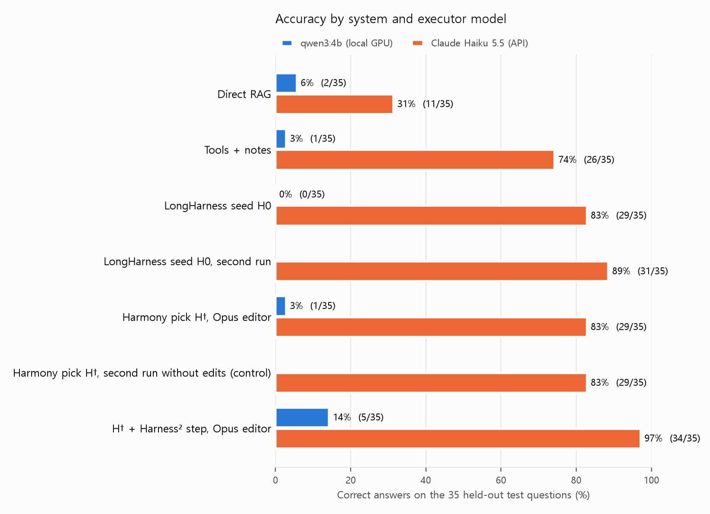
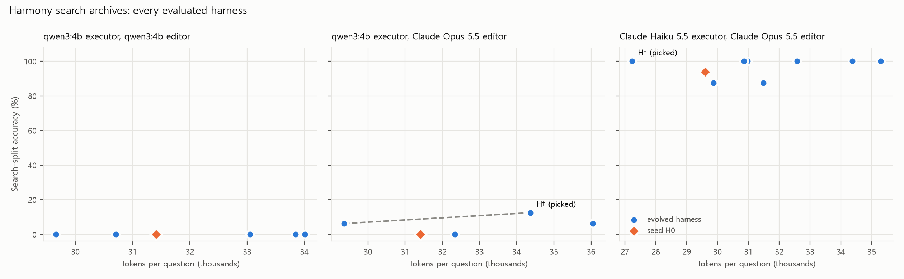

# harnessforge-lite-kr

English · [한국어](README.ko.md)

A self-evolving research agent for long Korean disclosure corpora, built by combining three October 2026
papers on **agent harnesses**: the code, prompts, tools and checks around a frozen model.

| Paper | Role in this agent |
|---|---|
| **[LongHarness](https://arxiv.org/abs/2610.13075)** (Huang et al.) | The runtime. An EvidenceBank with a lifecycle (active / superseded / retracted), a Conclusion State whose open gaps steer the next search, and citations to read spans only. |
| **[Harmony Harness](https://arxiv.org/abs/2610.15150)** (Yu et al.) | Offline search. MOEA/D over accuracy × token cost with Tchebycheff scalarization, operators factorized by component (tools / skills / logic) and scope (general / domain), and dynamic composition at inference. |
| **[Harness²](https://arxiv.org/abs/2610.14224)** (Xu et al.) | Test-time refinement with no answer key. An invariant editor and a domain editor each propose an edit, both are probed on the same task, a compose step keeps what the behavioural contrast supports, and lessons go into an experience library. |

> **Unofficial.** This project is not affiliated with the authors of any of these papers. Harness² has an
> official implementation at [google-research/harness2](https://github.com/google-research/harness2)
> (Apache-2.0), which needs Linux, Node.js and Vertex AI. This repository is a separate, much smaller
> re-implementation of the ideas. It is written from scratch. The core uses only the Python standard library
> and runs on a laptop with a free local model; Claude models are an optional backend. Its numbers are
> **not comparable** with the papers.

## Why these three fit together

All three papers improve the harness instead of the model, but they work at different time scales:

```
 offline, labelled search split                      online, unlabelled test task
 seed H0 ─► Harmony search (accuracy × cost) ─► H† ─► Harness² step per task ─► answer
             general / domain operators               invariant + domain proposals, probe, compose
                                                       └─► experience library (EXPERIENCE.md)
 every run is a LongHarness episode:
 search → read (span S#) → upsert evidence (E#) → revise → compute over E# → final citing E#, gated
```

Three design links tie them together.

1. **One scope split serves both evolution methods.** Harmony's general versus environment-specific
   components and Harness²'s invariant versus domain-specific editors use the same two folders
   (`general/` and `domain/dart/`). Transfer mode drops every domain component.
2. **LongHarness state makes Harness² probes judgeable without an answer key.** With an explicit
   EvidenceBank, "did the edit help?" becomes a set of checkable signals. These include whether a final
   was accepted, which gates rejected it, whether the cited value appears in the cited span, whether a
   superseded or preliminary filing was cited, and whether searches were repeated.
3. **Verification gates are harness components.** Gates such as `value_in_source`, `block_repeats`,
   `correction_check` and `preliminary_check` are switches on the LongHarness tools. Either loop can turn
   them on with an ordinary edit.

See [docs/design.md](docs/design.md) for the full mapping and every deviation from the papers.

## The task: a synthetic DART-style corpus with planted traps

LongHarness reports results on OfficeQA, numeric questions over U.S. Treasury bulletins. The Korean
analogue is DART filings. The corpus here is **synthetic**, so every gold answer and trap is exact.

* 16 fictional companies and 93 filings, about 600k characters in total. The filings are annual reports
  for three years, 2026 Q1 and half-year reports, six `[기재정정]` corrected annual reports, and seven
  잠정실적 preliminary disclosures. Every filing states that it is synthetic and unrelated to any real
  company.
* 51 questions, split by company: 16 are used for the search and 35 are held out for testing.
* The traps match the two failure modes LongHarness names. *Evidence-state drift* traps are a figure
  that a correction replaced, a preliminary figure, the separate (별도) statement instead of the
  consolidated (연결) one, and the cumulative column instead of the 3-month column. *Unbounded
  exploration* traps are look-alike numbers in long boilerplate, near-duplicate filings and confusable
  company names.
* An oracle policy replays every gold computation through the same tools. CI checks that all 51 questions
  can be answered within the turn budget, with every gate switched on.

**Benchmark v2 (no model results yet).** A larger set for the next round: 30 fictional companies, 234
filings and 173 questions in search, validation and test splits; new filing types (Q3 and audit reports,
corrected preliminary results, a change of name, restated figures); new question types and traps; and 15
questions that cannot be answered from the filings, where the right answer is "알 수 없음". A small real
set of 20 questions on six FY2025 DART annual reports is built locally with your own DART key. See
[docs/benchmark_v2.md](docs/benchmark_v2.md). The results below are all on v1.

## Quick start (no model needed)

```bash
pip install -e ".[dev]"
```

```bash
pytest -q
```

```bash
python -m harnessforge validate
```

```bash
python -m harnessforge build --out data/corpus
```

```bash
python -m harnessforge validate --bench v2
```

## Run with a free local model (Ollama)

Install [Ollama](https://ollama.com) and pull a small model that supports structured outputs. The
experiments below use `qwen3:4b`. Thinking is switched off automatically for qwen3, because otherwise
the model spends its whole output budget before writing the JSON action.

```bash
python -m harnessforge run --harness seed-longharness --model qwen3:4b --split test --out runs/e1_longharness
```

```bash
python -m harnessforge evolve --harness seed-longharness --model qwen3:4b --n-sub 4 --generations 2 --out runs/e2_harmony
```

```bash
python -m harnessforge refine --harness runs/e2_harmony/best --model qwen3:4b --k 1 --split test --out runs/e3_harness2
```

```bash
bash scripts/run_experiments.sh
```

`--editor-model` sets a different model for the harness editor. `--scopes general` runs in transfer mode.
Runs are cached per (harness hash, question, seed, model), Harmony continues from its checkpoint and Harness²
skips finished tasks, so an interrupted run resumes where it stopped.

## Run with Claude (optional)

```bash
pip install -e ".[claude]"
```

Put an API key in `ANTHROPIC_API_KEY`, or in a file outside the repository at
`~/.harnessforge/anthropic_api_key.txt` (another path can be set with `HARNESSFORGE_KEY_FILE`). The file is
handy when a running app cannot see a newly set environment variable. Then check the key with one tiny
request:

```bash
python -m harnessforge check-model --model claude-opus-5-5
```

Any `claude-*` model name works for `--model` (executor, default effort `low`) and `--editor-model` (editor,
default effort `medium`). Requests use structured JSON output. For the models that support it, they also turn
on server-side refusal fallbacks, so a false-positive safety decline is retried instead of failing the run.

```bash
python -m harnessforge evolve --model claude-haiku-5-5 --editor-model claude-opus-5-5 --out runs/h2_harmony
```

## Results

All numbers are from one sampling seed on the 35 held-out test questions (11 companies the search never
saw). The full tables, including every harness Harmony evaluated, are in
[reports/results.md](reports/results.md). Two executors were tested: `qwen3:4b` through Ollama on a laptop
RTX 2060 (6 GB, free), and Claude Haiku 5.5 through the API (effort low). The harness editor is either the
executor model itself or Claude Opus 5.5 (effort medium). Harness² likewise pairs weaker executors with a
stronger editor (Claude Opus 4.8 in the paper).



### Claude Haiku 5.5 executor, Claude Opus 5.5 editor

| System | Correct (of 35) | Tokens / question | $ / question |
|---|---|---|---|
| Direct RAG (top-6 chunks, one call) | 11 (31.4%) | 4,821 | 0.0007 |
| Tools + free-text notes | 26 (74.3%) | 23,513 | 0.0032 |
| LongHarness seed H0 | 29 (82.9%) | 29,007 | 0.0039 |
| LongHarness seed H0, second run | 31 (88.6%) | 31,217 | 0.0042 |
| Harmony pick H† | 29 (82.9%) | 32,232 | 0.0042 |
| Harmony pick H†, second run without edits (control) | 29 (82.9%) | 32,110 | 0.0042 |
| H† + Harness² step (k=1) | **34 (97.1%)** | 117,603 | 0.1064 |

* **Explicit evidence state beats free-text notes on the same tools.** The LongHarness seed answered 29 and 31
  questions on two runs, against 26 for the notes harness and 11 for one-shot retrieval. Its remaining errors
  were mostly unit slips (4 of 6), such as a 백만원 figure divided by 10 instead of 100.
* **Harmony improved the search split, but the gain did not transfer.** On the 16 search questions the
  picked harness went from 15 to 16 correct and used 8% fewer tokens. Its edits were a domain unit-conversion
  rule, the `unit_declared` gate and an always-on filing-navigation skill. On the 35 test questions it
  matched the seed at 29. Its edits traded error types: unit slips fell from 4 to 1, while two new
  separate-versus-consolidated mix-ups appeared. Sixteen search questions are too few to separate a real gain
  from noise.
* **Harness² fixed 5 test answers without an answer key and broke none.** The compose step adopted an edit
  on 16 of 35 tasks and kept the harness on the other 19. Each fix came with a reason taken from the runs
  themselves: a 천원 value off by a factor of ten, a separate statement read as consolidated (two tasks), and an
  agent that drifted to a confusably named company (세원바이오 versus 세원바이오텍, two tasks). The price is
  about 25 times the cost of a single run, almost all of it Opus editor calls ($3.26 for 35 tasks).
* **A control rules out a resampling effect.** A second run of H† with no edits also answered 29. It fixed one of
  the six errors and broke a different one. Even picking the better of the two plain runs for each question
  would reach only 30. The seed itself scored 29 and 31 on its two runs, so single runs move by about two
  questions. The five Harness² fixes are well outside that range.
* **The experience library recorded 4 lessons**, for example: once the latest `[기재정정]` filing has been
  read, stop re-checking for corrections. On that task the same answer took 21k tokens instead of 39k.

### qwen3:4b executor (local, free)

| System | Correct (of 35) |
|---|---|
| Direct RAG | 2 (5.7%) |
| Tools + free-text notes | 1 (2.9%) |
| LongHarness seed H0 | 0 (0.0%) |
| Harmony pick H† (Opus editor, 1 generation) | 1 (2.9%) |
| H† + Harness² step (Opus editor) | 5 (14.3%) |

* **A 4B model mostly fails at finishing, not at finding.** It usually locates the right table, but either
  repeats the same search until the turn budget runs out or converts units wrongly. The baseline harnesses
  all stay at 0 to 6% with this model.
* **The editor matters.** With `qwen3:4b` as its own editor, Harmony never left 0% on the search split in
  8 tries. Three edits were rejected by validation, and one of them was caused by an edit-schema bug that was
  fixed later. With Claude Opus 5.5 as the editor, one generation (4 tries) reached 2 of 16. The winning edit
  was a domain skill that tells the agent to prefer the `[기재정정]` filing and to do every unit conversion with
  `compute`. On the test split that pick answered 1 question on its own, and the Harness² step raised it to 5
  with none broken. Still, 20 of 35 episodes ended without an accepted answer, so a better editor cannot make
  up for a weak executor.



### Where the wrong answers went

Planted traps make failures countable. The table below covers the Haiku 5.5 runs. The full table, which
includes qwen3:4b and the per-question-type breakdown, is in [reports/results.md](reports/results.md).

| Haiku 5.5 system | Wrong or missing | No answer | Before correction | Separate basis | Preliminary | Unit slip | Other |
|---|---|---|---|---|---|---|---|
| Direct RAG | 24 | 0 | 0 | 0 | 5 | 8 | 11 |
| Tools + free-text notes | 9 | 0 | 0 | 1 | 0 | 6 | 2 |
| LongHarness seed H0 | 6 | 0 | 0 | 0 | 0 | 4 | 2 |
| Harmony pick H† | 6 | 1 | 0 | 2 | 0 | 1 | 2 |
| H† + Harness² step | 1 | 1 | 0 | 0 | 0 | 0 | 0 |

The traps that defeat one-shot retrieval are preliminary (잠정) figures and unit slips. Tool use with
explicit evidence removes the preliminary-figure errors entirely. What remains is mostly arithmetic on units,
plus a statement-basis or company mix-up, and those are what the per-task Harness² step repairs.

### Cost of the whole study

Claude API list prices: about $10 in total, mostly Opus editor calls in Harness². The qwen3:4b runs
are free and took about 11 hours of laptop GPU time.

## Conclusion and next steps

**What these runs support.** With a capable executor, explicit evidence state beat free-text notes and
one-shot retrieval on the same tools. Answer-key-free refinement per task (Harness²) fixed five test answers,
which is well outside what a plain rerun changes, at about 25 times the cost of a single run. Offline search on
16 labelled questions (Harmony) improved those questions but not the held-out ones. With a 4B executor, no
harness made up for the model; a stronger editor helped only a little.

**What they do not yet show.** Every configuration is one sample, the test set has 35 questions, the corpus
is synthetic, and only two executor models were tried. To turn these observations into claims, the study
needs more samples and more models:

1. **Repeat every configuration 3 to 5 times** and report intervals. Claude models cannot be seeded, so
   repetition is the only way to measure their variance.
2. **Try more executor models between the two extremes,** such as 8B to 30B open models and Claude Sonnet
   5.5. The interesting question is where harness gains start: they were absent at 4B and clear with Haiku 5.5.
3. **Give Harmony a larger search split and more generations,** so a gain on the search split can be told
   apart from noise and checked for transfer.
4. **Run Harness² with k > 1** and an ablation without the experience library, as the paper does.
5. **Cut Harness² cost:** fewer editor calls, a cheaper editor for easy tasks, and more reuse of the
   library.
6. **Move from synthetic to real DART filings** with questions checked against the DART financial API. The
   question sets for this round are built ([v2 and a small real set](docs/benchmark_v2.md)); no model has
   been run on them yet.

## What evolution may change, and what is frozen

The harness is a set of small files. **Tools**: `tool_guidance.md` plus three knobs, `search_k`,
`snippet_chars` and `read_chars`. **Skills**: short instruction files, each with a keyword trigger.
**Logic**: `system.md` and `domain.md`, knobs for turns, history window, skill count and thought
length, and gate switches. Every edit is a JSON operation that is validated before use. The checks
cover allowed component and scope, value bounds, size limits, and a leakage guard that rejects any
harness text naming a corpus company or containing a large specific figure.

The corpus, search index, tool semantics, scoring and gold answers are the frozen evaluator interface.
The Harness² loop never sees a gold answer. Harmony sees gold answers and trap labels only on the
search split, much as the Harmony paper uses failing tests on its evolve split.

## Limitations

* A small synthetic benchmark: 35 test questions and 16 search questions. The absolute numbers say little
  about frontier systems. The point is the relative comparisons and the failure analysis.
* One sampling seed per configuration. Claude models cannot be seeded, so each Claude row is one sample.
  Differences of one or two questions are within noise.
* The evolution budgets are small and unequal. Haiku used 2 Harmony generations (8 children). qwen3:4b with
  the Opus editor used 1 generation (4 children), to finish in time. Each Harness² step used k=1.
* History compaction differs from LongHarness. The paper keeps the full history, but an 8k-token local
  model cannot.
* Two incidents during the runs are recorded rather than hidden. One was an edit-schema bug that let editors
  omit required fields: both Claude-editor Harmony runs were restarted after the fix, and the qwen-editor run
  kept one rejected edit. The other was a network drop during the Haiku Harmony run, which resumed from its
  checkpoint.
* During development, the first five test questions were used to find tool bugs: thinking mode, read
  windows that cut off table headers, and doc ids placed in the wrong field. Seed prompts were not tuned
  on test questions.

## Layout

```
harnessforge/corpus/     synthetic filings, facts index, questions with gold and traps
harnessforge/retrieval.py  BM25 with Hangul bigrams and contextual chunk headers
harnessforge/runtime/    LongHarness state, tools, gates, policies, episode loop
harnessforge/harness/    genome files, validation, edit operators, dynamic composition
harnessforge/evolve/     Harmony (harmony.py), Harness² (harness2.py), editor prompts, digests
harnessforge/harness_seed/  seed harnesses: longharness and notes
docs/design.md           how the three papers map onto the code
docs/benchmark_v2.md     benchmark v2 (three splits, unanswerable questions) and the real DART set
reports/results.md       every table from the experiments (generated by scripts/make_report.py)
results/                 Harmony archives, picked harnesses, Harness² records and experience libraries
```

## License

MIT. The corpus is synthetic; any resemblance of a company name to a real company is coincidental.
